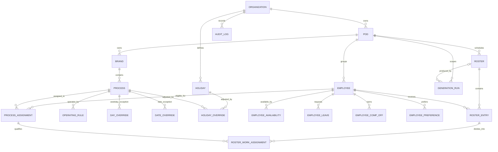

# Database Architecture

## Scope

This document describes the relational foundation. It establishes ownership, calendar/availability records, roster structures, generation-run tracking, and audit records. Organization, Pod, Brand, and Process CRUD routes are implemented. Roster generation and conflict resolution are not.

## Entity relationships

`Organization` is the top-level tenant. Pods, employees, and brands carry both `organization_id` and `pod_id` as applicable. Composite foreign keys ensure those identifiers describe the same ownership path. A Process references its Brand, Pod, and Organization together. An Employee Process Assignment references an Employee and Process with the same Organization and Pod.

Employees are associated with Brands through their Process Assignments: a Process belongs to one Brand, and an employee can have any number of Process Assignment rows. This permits assignment to multiple processes within one or multiple brands without duplicating employee identity.

## Calendar and employee availability

Operating calendars are Process-specific:

- `OperatingRule` stores recurring weekday hours and an effective date window. `sequence` supports multiple intervals on the same weekday.
- `DayOverride` stores recurring weekday exceptions over an effective window.
- `DateOverride` stores a one-off Process/date exception.
- `Holiday` stores an Organization holiday date; `HolidayOverride` defines Process-specific behavior for that holiday.
- Process `timezone` is an IANA timezone name used to interpret local calendar dates and wall-clock hours.

Employee availability is independent of operating hours. `EmployeeAvailability` stores a recurring employee weekday availability window. Leave, comp-off grants, and preferences are separate records and do not change a Process operating calendar.

Effective date windows use inclusive `effective_from` and `effective_to` dates. `effective_to` may be null for an open-ended window and must be on or after `effective_from`. Unique constraints prevent duplicate rows with the same owner/key/sequence and effective start. Employee email is unique within an Organization. The constraints do not prevent overlapping windows; application services must reject ambiguous overlaps before writes. The scheduling engine is outside this task.

Date/time instants use timezone-aware SQLAlchemy `DateTime` columns. SQLite accepts these values but does not preserve timezone metadata in the same way as PostgreSQL; convert to UTC at API boundaries and interpret operating hours in the Process timezone.

## Roster structure

A Roster is Pod-scoped so a daily employee entry can cover assignments across multiple brands and processes. `(roster_id, employee_id, work_date)` is unique, which provides one daily status per employee in a roster version. `RosterWorkAssignment` is a child row, so one daily entry can hold multiple work blocks. Composite foreign keys require every block and Process Assignment to belong to the same employee, Pod, and Organization.

The database checks that work blocks have a positive interval and that their employee/process assignment references are valid. It does not currently check that the block date falls inside the Process Assignment effective window, that work blocks do not overlap, or that the entry status permits work blocks. Those validations belong in the roster application/service layer before the scheduling engine is introduced.

Rosters are versioned by Pod and date period. Generation Runs can be Pod-wide or optionally scoped to one Process; an attached roster must belong to the same Pod and Organization. Audit Logs record a tenant, optional same-tenant employee actor, action, polymorphic entity reference, JSON payload, and timestamp. `entity_id` is intentionally polymorphic and therefore is not a foreign key. The table is append-oriented by convention; database triggers/permissions do not currently prevent updates or deletes.

## Legacy compatibility and migrations

Migration `0001_initial_schema` remains the original organization/employee/shift/assignment schema. Migration `0002_complete_roster_domain` adds the new domain tables and:

1. Creates a `Default` Pod for each existing Organization.
2. Backfills each existing Employee to that Pod.
3. Adds tenant scope to legacy shift assignments based on their Shift.
4. Rejects existing assignments whose Employee and Shift belong to different Organizations.
5. Adds same-tenant composite foreign keys and supporting unique constraints.

The migration test upgrades a populated `0001` SQLite database, verifies the backfill and schema, checks for model/schema drift, downgrades to `0001` while preserving legacy rows, then downgrades to base. SQLite migration connections temporarily disable FK enforcement to support table-rebuild operations and restore enforcement afterward; application connections enable `PRAGMA foreign_keys=ON`.

## PostgreSQL / Supabase

The ORM and migration use standard SQLAlchemy types and Psycopg's `postgresql+psycopg` dialect. PostgreSQL remains the deployment target. The migration and business-constraint suite currently run against SQLite only; PostgreSQL/Supabase compatibility has **not been verified by an actual PostgreSQL test**. Run the migration and constraints against a disposable PostgreSQL database before production deployment.

No Row Level Security policies or authentication-to-tenant mapping are defined. The organization structure endpoints currently have no authentication or authorization and are for development use only. Composite constraints protect relational ownership, but do not replace API access control. Do not expose these endpoints to untrusted clients until authorization is implemented.
