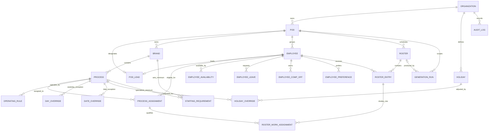

# Database Architecture

## Scope

This document describes the relational foundation, ownership, calendars and availability, roster structures, generation-run tracking, and audit records. Organization, Pod, Brand, Process, roster generation, and conflict-resolution APIs are implemented.

## Entity relationships

`Organization` is the top-level tenant. Pods, employees, and brands carry both `organization_id` and `pod_id` as applicable. Composite foreign keys ensure those identifiers describe the same ownership path. A Process references its Brand, Pod, and Organization together. An Employee Process Assignment references an Employee and Process with the same Organization and Pod. `PodLead` designates at most one employee per Pod, at most one Pod per employee, and composite foreign keys enforce that the lead belongs to that Pod and Organization.

Employees are associated with Brands through their Process Assignments: a Process belongs to one Brand, and an employee can have any number of Process Assignment rows. This permits assignment to multiple processes within one or multiple brands without duplicating employee identity.

## Calendar and employee availability

Operating calendars are Process-specific:

- `OperatingRule` stores recurring weekday hours and an effective date window. `sequence` supports multiple intervals on the same weekday.
- `DayOverride` stores recurring weekday exceptions over an effective window.
- `DateOverride` stores a one-off Process/date exception.
- `Holiday` stores an Organization holiday date; `HolidayOverride` defines Process-specific behavior for that holiday.
- Process `timezone` is an IANA timezone name used to interpret local calendar dates and wall-clock hours.
- Calendar APIs resolve effective days in this order: one-off date override, Process holiday override (or closed by default on a holiday), recurring weekday override, then recurring operating rule. Unconfigured dates default to closed.
- `StaffingRequirement` stores a Brand-wide or Process-specific minimum, optionally scoped to a weekday or one date. Process rows are constrained to the same Brand, Pod, and Organization. Effective staffing precedence is Process/date, Brand/date, Process/weekday, Brand/weekday, Process default, then Brand default.
- Holiday dates are unique per Organization. The staffing migration checks for existing duplicate holiday dates and aborts before DDL if any are found; it does not remove existing holiday records.

Employee availability is independent of operating hours. `EmployeeAvailability` stores a recurring employee weekday availability window. Leave, comp-off requests/grants, and preferences are separate records and do not change a Process operating calendar. Approved leave and approved comp-off requests block scheduling. The earned-hour `EmployeeCompOff` grant balance is not yet linked to dated comp-off requests. Leave requests are organization-scoped: overlapping requests are rejected, approval/rejection/cancellation follows explicit status transitions, and only approved requests block generation and count as validation conflicts. The leave API and UI require shared demo HTTP Basic credentials; role-specific reviewer authorization and per-user audit identity are not implemented.

Effective date windows use inclusive `effective_from` and `effective_to` dates. `effective_to` may be null for an open-ended window and must be on or after `effective_from`. Unique constraints prevent duplicate rows with the same owner/key/sequence and effective start. Employee email is unique within an Organization. The constraints do not prevent overlapping windows; application services must reject ambiguous overlaps before writes.

Date/time instants use timezone-aware SQLAlchemy `DateTime` columns. SQLite accepts these values but does not preserve timezone metadata in the same way as PostgreSQL; convert to UTC at API boundaries and interpret operating hours in the Process timezone.

## Roster structure

A Roster is Pod-scoped so a daily employee entry can cover assignments across multiple brands and processes. `(roster_id, employee_id, work_date)` is unique, which provides one daily status per employee in a roster version. `RosterWorkAssignment` is a child row, so one daily entry can hold multiple work blocks. Composite foreign keys require every block and Process Assignment to belong to the same employee, Pod, and Organization.

The database checks that work blocks have a positive interval and that their employee/process assignment references are valid. The monthly generator filters assignments by effective date and uses CP-SAT optional intervals with employee `NoOverlap` constraints before persisting blocks.

Monthly generation runs for one Organization/Pod and optionally one Process. Process minimums count unique employees scheduled to that Process for each open operating sequence; Brand minimums count unique employees scheduled to any selected open Process for that Brand/date. Calendar hours are emitted as full work blocks. Fairness minimizes total assigned blocks first and then workload spread; supported soft preference keys are `preferred_days_off` (`weekdays` and/or ISO `dates`) and `preferred_process_ids` (`process_ids`). Unknown preference keys are ignored. A run is bounded by a solver time limit. Infeasible runs persist a failed Generation Run with a relaxed diagnostic solve showing uncovered demand when the diagnostic completes; if it times out, coverage counts are explicitly unknown. No Roster is created for an infeasible problem.

Saved roster validation independently checks effective process eligibility, approved leave, recurring employee availability, process operating intervals, overlapping/duplicate work blocks, and process/brand minimum staffing. Coverage excludes assignments that violate those hard constraints and validation returns concrete replacement candidates only when eligibility, availability, leave, calendar and work-block overlap checks pass. Manual edits are validated in the same database transaction and rolled back on conflict. `RosterWorkAssignment.is_locked` persists manual locks; regeneration can take a source roster ID and carries its valid locked blocks as fixed CP-SAT assignments. Locks that conflict with changed hard constraints make regeneration fail rather than being discarded. Migration `0005_roster_assignment_locks` adds this field. Organization routes require shared demo HTTP Basic credentials; role-specific permissions are not implemented.

Employee availability rules with no active row default to available; active explicit unavailable weekday rows block work, and available time windows must contain the full operating block. Approved leave and comp-off request intervals block overlapping work blocks. Comp-off grants and usage balances are not linked to dated requests, so the engine cannot validate earned-hour balances. The legacy `Shift` table is not used because it has no Process relationship; generated blocks use Process operating intervals. Employees have no timezone field, so availability wall-clock rules are interpreted in each candidate Process timezone.

Rosters are versioned by Pod and date period. Generation Runs can be Pod-wide or optionally scoped to one Process; an attached roster must belong to the same Pod and Organization. Audit Logs record a tenant, optional same-tenant employee actor, action, polymorphic entity reference, JSON payload, and timestamp. `entity_id` is intentionally polymorphic and therefore is not a foreign key. The table is append-oriented by convention; database triggers/permissions do not currently prevent updates or deletes.

## Legacy compatibility and migrations

Migration `0001_initial_schema` remains the original organization/employee/shift/assignment schema. Migration `0002_complete_roster_domain` adds the new domain tables and:

1. Creates a `Default` Pod for each existing Organization.
2. Backfills each existing Employee to that Pod.
3. Adds tenant scope to legacy shift assignments based on their Shift.
4. Rejects existing assignments whose Employee and Shift belong to different Organizations.
5. Adds same-tenant composite foreign keys and supporting unique constraints.

Migrations `0003_employee_active_status` and `0004_staffing_requirements` add employee status and minimum staffing rules. The latter also tightens holiday uniqueness to one holiday per Organization/date and adds a Process/Brand composite key for staffing ownership. Migration `0006_pod_leads` adds the optional Pod Lead association without changing existing Pod or employee rows. The migration test upgrades a populated `0001` SQLite database, verifies the backfill and schema, checks for model/schema drift, downgrades to `0001` while preserving legacy rows, then downgrades to base. SQLite migration connections temporarily disable FK enforcement to support table-rebuild operations and restore enforcement afterward; application connections enable `PRAGMA foreign_keys=ON`.

## PostgreSQL / Supabase (not the selected deployment)

The project decision for this assessment is to keep SQLite. PostgreSQL/Supabase is not configured or required for deployment. Optional SQLite-to-PostgreSQL transfer tooling is not evidence of PostgreSQL compatibility; the migrations and business-constraint suite have not been verified against an actual disposable PostgreSQL instance.

All organization APIs require shared demo HTTP Basic credentials. Composite constraints protect relational ownership, but do not provide per-user identity or role-based authorization. PostgreSQL Row Level Security and tenant-to-user mapping are not implemented.
